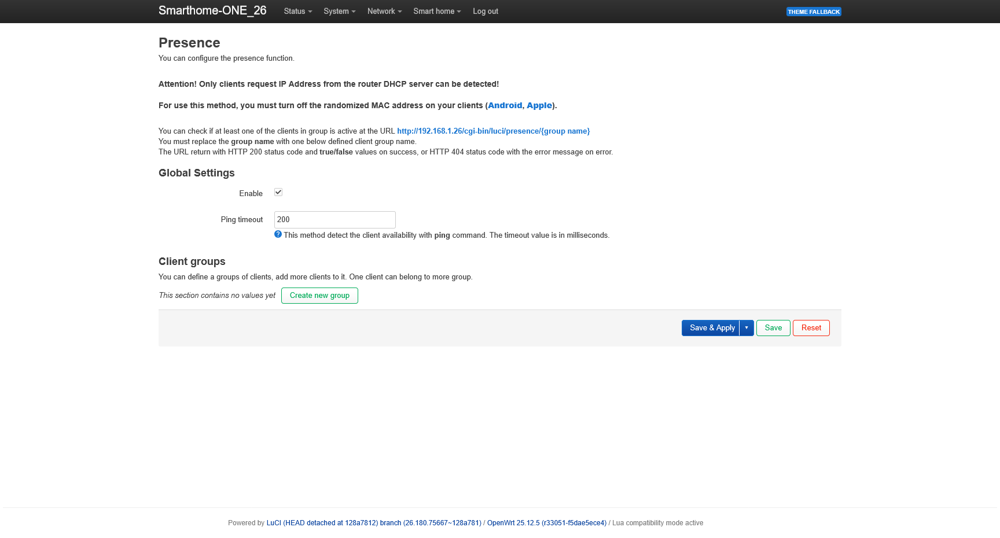
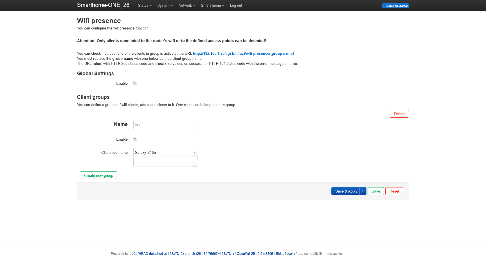
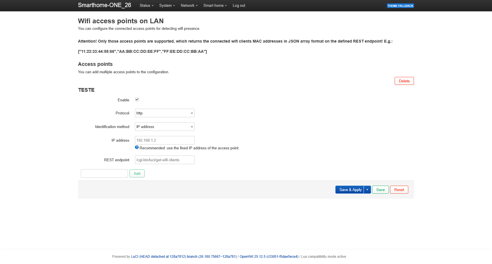

# OpenWrt Presence

Presence detection module for OpenWrt with Wi-Fi, ping and multi-access-point support.

The module can be installed on a standard OpenWrt system and provides presence information through the LuCI interface and simple HTTP endpoints.

## Features

- Wi-Fi-based presence detection
- Network-based presence detection using ping
- Multiple presence groups
- Multiple OpenWrt access point support
- Secondary access points configurable by IP address or MAC address
- LuCI configuration interface
- Simple HTTP API with `true` / `false` responses
- Support for both `apk` and `opkg` based OpenWrt versions
- Reinstallation without overwriting existing configuration

## Installation

Connect to the OpenWrt router via SSH and run:

    wget -qO- https://raw.githubusercontent.com/szelessavalapitvany/openwrt-presence/main/install.sh | sh

The installer automatically detects the package manager, installs the required dependencies, downloads the module files and restarts the required LuCI services.

## LuCI menu

After installation, a new menu appears:

    Smart home
    ├── Presence
    ├── Wifi presence
    └── Access points

### Presence

Network-based presence detection.

The router reads DHCP lease information, determines the IP address of the configured device and checks availability using ping.

Multiple MAC addresses can be assigned to one presence group.

A group is considered present if at least one configured device is reachable.

#### Screenshot

### Wifi presence

Wi-Fi-based presence detection.

OpenWrt checks the list of clients currently connected to the local Wi-Fi interfaces.

Clients are identified by hostname and associated with their MAC addresses using DHCP lease information.

Clients connected to configured secondary OpenWrt access points can also be included.

#### Screenshot

### Access points

Additional OpenWrt routers or access points can be included in Wi-Fi presence detection.

The main router queries the secondary access points for their currently connected Wi-Fi clients.

Access points can be identified by:

- IP address — recommended
- MAC address — available as a fallback method

Using a fixed IP address for secondary access points is recommended because it does not depend on a DHCP lease being available.

The default REST endpoint is:

    /cgi-bin/luci/get-wifi-clients

A lightweight client-list API must be installed on every secondary OpenWrt access point.

Project:

https://github.com/szelessavalapitvany/openwrt-wifi-client-api

Install it on the secondary OpenWrt router with:

    wget -qO- https://raw.githubusercontent.com/szelessavalapitvany/openwrt-wifi-client-api/main/install.sh | sh

The endpoint returns the MAC addresses of currently connected Wi-Fi clients as a JSON array.

Example:

    [
      "11:22:33:44:55:66",
      "AA:BB:CC:DD:EE:FF"
    ]

#### Screenshot

## HTTP API

Network-based presence:

    http://ROUTER-IP/cgi-bin/luci/presence/GROUPNAME

Wi-Fi-based presence:

    http://ROUTER-IP/cgi-bin/luci/wifi-presence/GROUPNAME

Possible responses:

    true

or:

    false

## Mobile devices

Modern phones often use randomized or private MAC addresses.

For reliable presence detection, use a fixed MAC address for the home Wi-Fi network.

## Updates

The installer can be run again at any time.

Existing configuration files under `/etc/config/` are preserved, so previously configured presence groups and access point settings are not overwritten.

## Documentation

Hungarian documentation:

https://www.szelessavmuhely.hu/hu/jelenlet_erzekeles

---

# OpenWrt jelenlétérzékelés

OpenWrt jelenlétérzékelő modul Wi-Fi, ping és több access point támogatással.

A modul hagyományos OpenWrt rendszerre is telepíthető, és a jelenléti információ LuCI felületen, valamint egyszerű HTTP végpontokon keresztül érhető el.

## Funkciók

- Wi-Fi alapú jelenlétérzékelés
- Hálózat alapú jelenlétérzékelés ping segítségével
- Több jelenléti csoport
- Több OpenWrt access point támogatása
- Másodlagos access pointok megadása IP-cím vagy MAC-cím alapján
- LuCI beállítófelület
- Egyszerű HTTP API `true` / `false` válasszal
- `apk` és `opkg` alapú OpenWrt verziók támogatása
- Újratelepítés a meglévő konfiguráció megtartásával

## Telepítés

Jelentkezz be SSH-n keresztül az OpenWrt routerre, majd futtasd:

    wget -qO- https://raw.githubusercontent.com/szelessavalapitvany/openwrt-presence/main/install.sh | sh

A telepítő automatikusan felismeri a csomagkezelőt, telepíti a szükséges függőségeket, letölti a modul fájljait, majd újraindítja a szükséges LuCI szolgáltatásokat.

## LuCI menü

Telepítés után megjelenik egy új menü:

    Smart home
    ├── Presence
    ├── Wifi presence
    └── Access points

### Presence

Hálózat alapú jelenlétérzékelés.

A router a DHCP lease adatokból meghatározza a beállított eszköz IP-címét, majd ping segítségével ellenőrzi az elérhetőségét.

Egy jelenléti csoporthoz több MAC-cím is megadható.

A csoport akkor tekinthető jelenlévőnek, ha legalább egy beállított eszköz elérhető.

#### Képernyőkép

### Wifi presence

Wi-Fi alapú jelenlétérzékelés.

Az OpenWrt az aktuálisan a helyi Wi-Fi interfészekhez csatlakozott kliensek listáját vizsgálja.

A kliensek azonosítása hostname alapján történik, amelyet a rendszer DHCP lease adatok segítségével kapcsol össze a MAC-címmel.

A beállított másodlagos OpenWrt access pointokhoz csatlakozott kliensek is bevonhatók a jelenlétérzékelésbe.

#### Képernyőkép

### Access points

További OpenWrt routerek vagy access pointok is bevonhatók a Wi-Fi jelenlétérzékelésbe.

A főrouter lekérdezi a másodlagos access pointokat az aktuálisan kapcsolódó Wi-Fi kliensekről.

Az access point azonosítása kétféleképpen történhet:

- IP-cím alapján — ajánlott
- MAC-cím alapján — tartalék lehetőségként

A másodlagos access pointokhoz fix IP-cím használata ajánlott, mert így a működés nem függ attól, hogy az access point rendelkezik-e DHCP lease bejegyzéssel.

Az alapértelmezett REST végpont:

    /cgi-bin/luci/get-wifi-clients

Minden másodlagos OpenWrt access pointra telepíteni kell a könnyű klienslista API modult.

Projekt:

https://github.com/szelessavalapitvany/openwrt-wifi-client-api

Telepítés a másodlagos OpenWrt routeren:

    wget -qO- https://raw.githubusercontent.com/szelessavalapitvany/openwrt-wifi-client-api/main/install.sh | sh

A végpont JSON tömbként adja vissza az aktuálisan csatlakozott Wi-Fi kliensek MAC-címeit.

Példa:

    [
      "11:22:33:44:55:66",
      "AA:BB:CC:DD:EE:FF"
    ]

#### Képernyőkép

## HTTP API

Hálózat alapú jelenlét:

    http://ROUTER-IP/cgi-bin/luci/presence/CSOPORTNEV

Wi-Fi alapú jelenlét:

    http://ROUTER-IP/cgi-bin/luci/wifi-presence/CSOPORTNEV

Sikeres lekérdezés esetén a válasz:

    true

vagy:

    false

## Mobil eszközök

A modern telefonok gyakran véletlenszerű vagy privát MAC-címet használnak.

A megbízható jelenlétérzékeléshez célszerű az otthoni Wi-Fi hálózathoz fix MAC-címet használni.

## Frissítés

A telepítő bármikor újra futtatható.

A meglévő `/etc/config/` alatti konfigurációs fájlokat a telepítő nem írja felül, így a már létrehozott jelenléti csoportok és access point beállítások megmaradnak.

## Dokumentáció

Magyar dokumentáció:

https://www.szelessavmuhely.hu/hu/jelenlet_erzekeles
